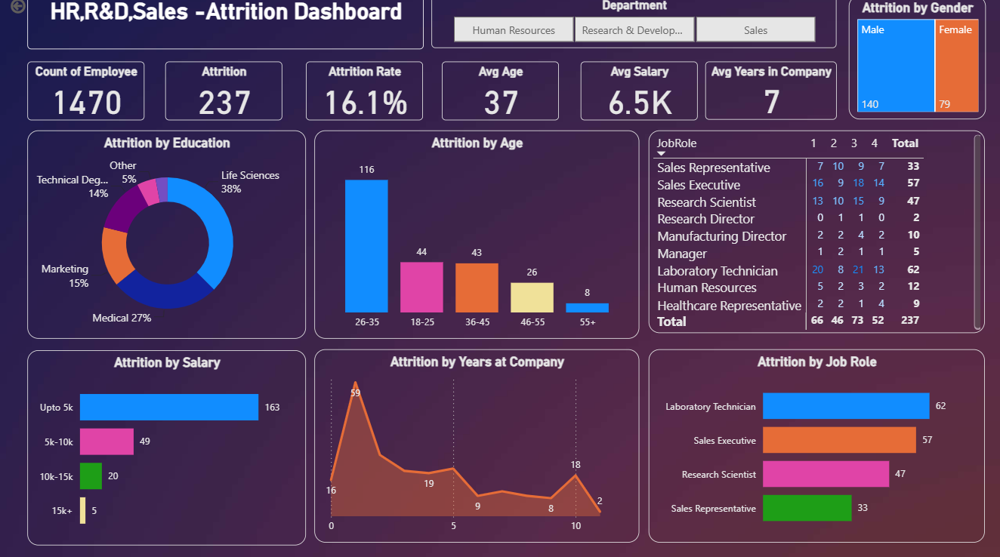

# HR Analytics Dashboard | Microsoft Power BI

**An Interactive Business Intelligence Project for Workforce Analytics & Employee Attrition Analysis**

##  Project Overview

This project focuses on analyzing HR workforce data and presenting meaningful insights through an interactive Power BI dashboard.

The dashboard is designed to support data-driven HR decision-making by exploring employee attrition patterns, workforce distribution, and department-level trends.

It demonstrates practical Business Intelligence skills, including data preparation, data modeling, DAX development, interactive visualization, and Row-Level Security (RLS).

##  Dashboard Preview



##  Business Objectives

- Analyze employee attrition patterns.
- Explore workforce distribution across departments and regions.
- Identify HR trends through interactive visualizations.
- Present key workforce indicators in an accessible format.
- Demonstrate role-based data access using Power BI RLS.

##  Technical Stack

| Technology | Application |
|---|---|
| Microsoft Power BI | Dashboard development |
| Power Query | Data cleaning and transformation |
| DAX | Measures and calculated columns |
| Data Modeling | Organizing analytical data |
| Power BI RLS | Role-based data access |
| GitHub | Project versioning and documentation |

##  Key Analytical Components

**1. Workforce Analytics**
- Employee distribution and workforce analysis.
- Department-wise employee analysis.
- Regional workforce distribution.

**2. Employee Attrition Analysis**
- Exploration of employee attrition patterns.
- Analysis of workforce trends.
- Interactive exploration using filters and slicers.

**3. Interactive Data Visualization**
- KPI cards and analytical visuals.
- Dynamic filtering and slicers.
- Department and regional analysis.

**4. Row-Level Security (RLS)**
- Created regional security assignments for practice.
- Configured role-based filters.
- Tested data visibility across different roles.

*Note: Regional assignments are illustrative and intended for RLS learning and demonstration, not actual organizational access control.*

## ⚙️ Data Analytics Workflow

```text
HR Dataset
    |
    v
Data Preparation
(Power Query)
    |
    v
Data Transformation
    |
    v
Data Modeling
    |
    v
DAX Calculations
    |
    v
Dashboard Development
    |
    v
Insights & Analysis
    |
    v
RLS Implementation
```

## 📁 Repository Structure

```text
PowerBI-Dashboard/
│
├── Data/
│   └── dashboard-overview.png
│
├── Attrition-dashboard.pbix
│
└── README.md
```

##  How to Access the Project

1. Clone or download this repository.
2. Download `Attrition-dashboard.pbix`.
3. Install Microsoft Power BI Desktop.
4. Open the PBIX file.
5. Explore the report, interactive filters, visualizations, and DAX calculations.

## 💼 Skills Demonstrated

- Business Intelligence
- HR Data Analytics
- Data Cleaning & Transformation
- Power Query
- DAX
- Data Modeling
- Data Visualization
- Interactive Dashboard Development
- Row-Level Security (RLS)
- Analytical Problem Solving

---

*Developed as a hands-on Business Intelligence project to demonstrate practical Power BI and HR analytics capabilities.*
